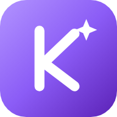

<div align="center">



# Knowly

**Tu compañero de estudio con IA, gratis y de código abierto.**

Sube fotos de la pizarra, del libro, PDFs o apuntes escritos a mano. Knowly los ordena por materias y te prepara guías, flashcards, quizzes, simulacros de examen, clases en pizarra con voz y podcasts.

Usa **tu propia API key** de Anthropic (Claude), que se queda en tu navegador. Pagas solo lo que usas, normalmente 1-4 $ al mes.

[](https://app.netlify.com/start/deploy?repository=https://github.com/loystudio-tech/Knowly)

[English](README.md) · [Cómo instalarlo](#instalación) · [App de escritorio](#app-de-escritorio) · [Funciones](#funciones) · [Privacidad](#privacidad-y-datos)

</div>

---

## Funciones

| | |
|---|---|
| **Mochila** | Suelta hasta 30 capturas, fotos, PDFs o Word. Knowly lee cada uno y lo clasifica por **tipo** (explicación, ejercicios, deberes, examen, apuntes) y por **clase** (Mates, Física…). Una pizarra con teoría es una explicación; una pizarra con ejercicios A, B, C son ejercicios. Puedes renombrar o unir clases (por ejemplo Física y Química) y, con cualquier selección, repasar, generar ejercicios nuevos, preparar un examen o crear una skill. |
| **Deberes** | Sube una foto o captura y olvídate: Knowly lo prepara en segundo plano. **Te lo explica paso a paso en vez de solo resolverlo** (primero pistas, luego compruebas tu respuesta), con chat de tutor, pizarra con voz, lectura en voz alta con traducción y vocabulario para alemán, español u otros idiomas, lo pone en el calendario (y cuándo leerlo) y, si es material de examen, crea guía de estudio, flashcards, test y un plan con cuenta atrás. |
| **Crear desde…** | Todas las pantallas de «crear» (flashcards, quiz, guía, examen, skill, deberes) aceptan hasta 10 fuentes: archivos, texto pegado, **YouTube**, **vídeo** (se analizan fotogramas), enlaces públicos de **Google Drive**, páginas web, cámara, arrastrar y soltar, Word y PowerPoint. |
| **Solver** | Resuelve problemas paso a paso a partir de texto, una foto, un PDF o algo escrito a mano (también con Apple Pencil). Puedes preguntarle sobre la solución. |
| **Pizarra** | Una clase que se va escribiendo paso a paso, con dibujos y voz. |
| **Sets de estudio** | Se crean desde tus archivos y se ordenan solos por materia. Cada set trae guía de estudio, guía de repaso, flashcards, quiz, simulacro, chuleta, podcast y un tutor con chat (también por voz). |
| **Repaso diario** | Repetición espaciada con todas tus flashcards, racha de días y mapa de actividad. |
| **Predictor de exámenes** | Temas más probables, plan de estudio día a día, simulacros y chuleta. |
| **Skills** (`/`) | Sube un PDF o fotos con ejercicios hechos a tu manera (o a la de tu profe). Knowly aprende el método y lo aplica cuando escribes `/nombre`. También crea ejercicios nuevos y te enseña el método en la pizarra. |
| **Automatizaciones** | Monta reglas con **bloques**, como en Scratch (arrastrar y soltar, con `si / entonces / si no`), o usa la lista de pasos sencilla. Ejemplo: «El día del examen → resumen rápido + aviso por la mañana para repasar». Se activan al subir material, al ordenar la mochila, al tener los deberes listos, al apuntar un examen, N días antes de un examen, al sacar mala nota o cada día. |
| **Escritura** | Corrector, mejorar redacción, parafrasear, resumir, citas (APA, MLA…) y explicar textos. |
| **Calendario** | Deberes, lecturas y exámenes (con hora opcional), avisos dentro de la app (campana) y **exportación .ics** con alarmas para tu app de calendario. |
| ⌘ **Buscador** | ⌘K / Ctrl+K para ir a cualquier sitio o lanzar acciones. |

Funciona en **Mac, PC, iPad y móvil**. Se instala como app (PWA), tiene modo oscuro y claro, y abre sin conexión.

---

## Instalación

Knowly funciona **en cualquier sitio**: como app de escritorio, en el navegador o en cualquier alojamiento. Siempre usas **tu propia API key** de Anthropic. Créala en [console.anthropic.com/settings/keys](https://console.anthropic.com/settings/keys) y pon un límite de gasto mensual en **Settings → Limits** (por ejemplo, 10 $).

| Quiero… | Usar | ¿Necesita servidor? |
|---|---|---|
| Usarla como **app de Mac / Windows / Linux** | [App de escritorio](#app-de-escritorio) | No |
| Probarla en 1 minuto | [Abrir `index.html` / GitHub Pages](#sin-servidor-lo-más-rápido) | No |
| Ponerla online para mí o mi clase | [Netlify](#netlify) · [Vercel](#vercel) · [Cloudflare Pages](#cloudflare-pages) | Sí (incluido) |
| Alojarla en mi ordenador, VPS, Render, Railway… | [Servidor Node](#cualquier-servidor-node) | Sí (incluido) |

**Cada persona usa su propia clave.** Cuando Knowly está alojado (Netlify, Vercel, Cloudflare…) la web **no guarda ningún secreto**: cada visitante pega su API key de Anthropic en **Ajustes → Mi propia clave**. La clave se guarda solo en el navegador de esa persona y se envía únicamente a `api.anthropic.com`. No pasa por el alojamiento, así que nadie (ni quien desplegó la web) puede ver ni gastar la clave de otro. El despliegue incluye una Content-Security-Policy estricta (`netlify.toml`, `vercel.json`, `_headers`, `server.js`) para que el navegador se niegue a enviar nada a otro dominio.

Límites que te protegen:
- **Límite de gasto en la propia clave:** en la Console de Anthropic pon **Settings → Limits** (límite mensual). Lo ideal es crear un Workspace aparte para Knowly con su propio límite. Es el único límite que de verdad frena una clave.
- **Límite diario dentro de la app:** **Ajustes → Límite diario** (300 mil / 1 millón / 3 millones de tokens al día, por dispositivo). Al llegar, Knowly deja de llamar a la IA hasta mañana.
- **Límite mensual, ritmo de peticiones y automatizaciones:** también en Ajustes (5 / 15 / 50 millones de tokens al mes; por defecto 15 M), más un tope fijo de 60 peticiones a la IA por minuto y 30 automatizaciones al día. Son por navegador: protegen de accidentes, no de alguien que tenga tu clave.
- **Solo tu web:** la página carga todos sus scripts desde su propio dominio (sin CDN de terceros) y una Content-Security-Policy estricta solo permite conectar con la propia web y con `api.anthropic.com`. El proxy privado opcional rechaza peticiones cuyo `Origin` sea otra web. Ojo: una clave de Anthropic no se puede atar a un dominio; por eso cada visitante usa la suya.
- **Tope por petición:** ninguna petición puede pedir más de 16.000 tokens de salida.

Opcional, solo para servidores **privados**: **Servidor con contraseña**. Si pones `ANTHROPIC_API_KEY` y `APP_PASSWORD` como variables de entorno, quien sepa la contraseña usa *tu* clave a través de `/api/ai`. No lo hagas en una web que compartas públicamente sin la contraseña.

Todo usa el mismo endpoint `/api/ai`, así que da igual qué alojamiento elijas.

### App de escritorio

Descarga el último `.dmg` (Mac), `.exe` (Windows) o `.AppImage` (Linux) desde [Releases](../../releases), ábrelo y pega tu key en **Ajustes → Clave directa**.

- **Mac:** la app no está firmada por Apple. La primera vez, clic derecho → **Abrir** (o **Ajustes del Sistema → Privacidad y seguridad → Abrir igualmente**).
- Las voces que leen en alto usan las del sistema y funcionan en todas. El dictado con micrófono puede no funcionar en la app de escritorio; usa la versión web instalada como app.
- **Compilarla tú:** `cd desktop && npm install && npm run dist` (queda en `desktop/dist`).
- **Publicar tu propia versión:** sube una etiqueta (`git tag v1.0.0 && git push --tags`). GitHub Actions compila las tres apps y las adjunta a un Release.

### Sin servidor (lo más rápido)

1. Descarga el repo (**Code → Download ZIP**) y abre `index.html` en Chrome o Safari. También puedes publicarlo gratis en **GitHub Pages**.
2. En **Ajustes → Clave directa**, pega tu API key.

### Netlify

Pulsa el botón **Deploy to Netlify** de arriba (o **Add new site → Import from Git**). No hace falta ninguna variable de entorno. Abre la web, ve a **Ajustes** y pega tu clave. El proxy opcional para servidores privados es `netlify/edge-functions/ai.js`.

> Arrastrar la carpeta a *Netlify Drop* no sirve, porque la función de la IA no se publicaría.

### Vercel

**Add New → Project → Import** este repo. Deja la configuración de build vacía (framework «Other») No hace falta ninguna variable de entorno. El proxy opcional para servidores privados es `api/ai.js`.

### Cloudflare Pages

**Workers & Pages → Create → Pages → Connect to Git.** Deja el comando de build vacío y el directorio de salida en `/`. No hace falta ninguna variable de entorno. El proxy opcional para servidores privados es `functions/api/ai.js`.

### Cualquier servidor Node

```bash
git clone https://github.com/loystudio-tech/Knowly.git && cd Knowly
node server.js          # público: cada persona pega su clave en la app
# privado: ANTHROPIC_API_KEY=sk-ant-... APP_PASSWORD=tu-contraseña node server.js
```

Necesita Node 18+. En Render o Railway usa `npm start` como comando de inicio. Opcional: `PORT` (por defecto 8787); las dos variables solo para un servidor privado.

### Instalarla como app desde el navegador

- **iPad o iPhone:** en Safari, **Compartir → Añadir a pantalla de inicio**.
- **Mac:** en Safari, **Archivo → Añadir al Dock**. En Chrome, usa el icono de instalar de la barra de direcciones.

---

## Qué puede y qué no puede hacer (límites reales)

- **No envía correos de verdad.** Knowly no tiene un servidor que mande emails. Los avisos son una campana dentro de la app, notificaciones del navegador (con la app abierta), **archivos .ics cuyas alarmas dispara tu app de calendario aunque Knowly esté cerrada** y un botón «enviarme un email» que abre tu correo (`mailto:`).
- **No oye audio.** Claude lee imágenes y texto, no sonido. Los vídeos se analizan por fotogramas (diapositivas, pizarra); para lo que se dice en voz sube los subtítulos (`.srt` / `.vtt`) o pega la transcripción. Los archivos de audio no están soportados.
- **YouTube, Drive y páginas web** los descarga el endpoint del servidor `/api/source` (necesita estar alojado en Netlify, Vercel, Cloudflare o Node — no funciona en la app de escritorio ni con un `index.html` suelto; ahí puedes seguir subiendo archivos y vídeo o pegando texto y transcripciones). El endpoint no guarda secretos; si pones `APP_PASSWORD`, pasa a ser obligatoria. YouTube puede bloquear las direcciones de servidores; en ese caso la app te avisa y puedes pegar la transcripción. Drive solo funciona con archivos compartidos con «cualquiera que tenga el enlace».
- **Las voces** son las de tu dispositivo (puedes elegir una por idioma en Ajustes). No hay voces neuronales de pago.
- Las alarmas del `.ics` y la campana necesitan que abras el archivo de calendario o la app al menos una vez.

## Privacidad y datos

- **Tus apuntes, sets y progreso se guardan en tu navegador** (IndexedDB). No hay base de datos ni cuentas.
- Los archivos solo se envían a la API de Anthropic cuando le pides algo a la IA.
- Para cambiar de dispositivo: **Ajustes → Exportar** y luego **Importar** en el otro.
- No hay analíticas ni rastreo.
- Tu API key no se guarda nunca en este repositorio ni en el alojamiento: vive solo en tu navegador o app (localStorage), no se incluye en las copias de seguridad y puedes quitarla cuando quieras en **Ajustes**.

## ¿Cuánto cuesta?

Knowly es gratis. Solo pagas el uso de la API de Anthropic. Con Sonnet 5.5, un mes normal de estudio sale por unos 1-4 $. Puedes elegir **Haiku 5.5** en Ajustes, que es mucho más barato. Las voces de la pizarra y el podcast son las del navegador, así que son gratis.

## Cómo está hecho

- **Un solo archivo** (`index.html`) con HTML, CSS y JavaScript sin frameworks.
- Un segundo endpoint, `/api/source`, que descarga transcripciones de YouTube, archivos de Drive y páginas web (lógica común en `lib/source.js`; la copia de Netlify se genera con `scripts/sync-netlify-source.sh`, ejecútalo tras editar `lib/source.js`).
- Un proxy pequeño (`/api/ai`) que añade tu API key y comprueba la contraseña. Usa *streaming*, así que las respuestas largas no se cortan. Hay una versión por alojamiento: `netlify/edge-functions/ai.js`, `api/ai.js` (Vercel), `functions/api/ai.js` (Cloudflare) y `server.js` (Node).
- `desktop/`: un envoltorio de Electron que empaqueta el mismo `index.html` como app de Mac, Windows y Linux.
- Librerías por CDN: [marked](https://github.com/markedjs/marked), [KaTeX](https://katex.org) y [DOMPurify](https://github.com/cure53/DOMPurify).
- Para el formato JSON usa las *structured outputs* de la API de Claude.

¿Quieres cambiar el nombre? Busca `const APP_NAME = 'Knowly';` en `index.html`.

## Contribuir

Los issues y pull requests son bienvenidos. Ideas pendientes:

- Sincronizar entre dispositivos (opcional, con Firebase o Supabase).
- Recordatorios por email de verdad (necesita un pequeño backend y un proveedor de correo).
- Voces más naturales (TTS de pago, opcional).
- Transcribir audio (grabaciones de clase) con un proveedor de voz a texto opcional.

## Licencia

[MIT](LICENSE): úsalo, modifícalo y compártelo libremente.

Knowly es un proyecto independiente y no está afiliado a Anthropic ni a ninguna otra app de estudio.

---

## English

**Knowly** is a free, open-source AI study companion. Upload photos of the whiteboard, textbook pages, PDFs or handwritten notes. Knowly organizes them by subject and builds study guides, flashcards, quizzes, mock exams, whiteboard lessons with voice, podcasts and a spaced-repetition daily review. You can also teach it your own method with **Skills** (`/skill`) and set up **Automations** (e.g. "every time I upload notes, create flashcards and a quiz").

It runs on **your own Anthropic API key**:

- **One click:** use the **Deploy to Netlify** button (no secrets needed) and paste your own key in *Ajustes*.
- **No server:** open `index.html` (or host it on GitHub Pages) and paste your key in *Ajustes → Clave directa*. The key stays in your browser.

All data stays in your browser (IndexedDB), with no accounts and no tracking. The interface is in Spanish. MIT licensed.
