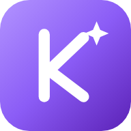

<div align="center">



# Knowly

**Your AI study companion. Free and open source.**

Upload photos of the whiteboard, textbook pages, PDFs or handwritten notes. Knowly sorts them by subject and builds study guides, flashcards, quizzes, mock exams, whiteboard lessons with voice, and podcasts.

It runs on **your own Anthropic (Claude) API key**. You pay only for what you use, usually $1–4 per month.

[](https://app.netlify.com/start/deploy?repository=https://github.com/loystudio-tech/Knowly)

[Features](#features) · [Setup](#setup) · [Privacy](#privacy-and-data) · [Cost](#cost) · [Contributing](#contributing) · [Español](README.es.md)

</div>

---

## Features

| | |
|---|---|
| 🧮 **Solver** | Solves problems step by step from text, a photo, a PDF or handwriting (Apple Pencil works too). You can ask follow-up questions about the solution. |
| 🧑‍🏫 **Whiteboard tutor** | A lesson that writes itself step by step, with drawings and a voice. |
| 📚 **Study sets** | Built from your files and sorted by subject automatically. Each set includes a study guide, review guide, flashcards, quiz, mock exam, cheat sheet, podcast and a chat tutor (voice supported). |
| 🔁 **Daily review** | Spaced repetition across all your flashcards, with a day streak and an activity heatmap. |
| 🎯 **Exam predictor** | Most likely topics, a day-by-day study plan, mock exams and a cheat sheet. |
| ✨ **Skills** (`/`) | Upload a PDF or photos with exercises solved your way (or your teacher's way). Knowly learns the method and applies it whenever you type `/skill-name`. It can also generate new exercises and teach the method on the whiteboard. |
| ⚡ **Automations** | "When I upload Math notes → create flashcards, a quiz and 5 exercises with my skill." Triggered when you upload material, add an exam, score low on a quiz, or every day. |
| ✍️ **Writing tools** | Proofreader, rewrite, paraphrase, summarize, citations (APA, MLA…) and text explainer. |
| 🎙️ **Live notes** | Transcribes a class with your microphone and turns it into study material. |
| 📅 **Calendar** | Homework and exams with reminders and a "Prepare with AI" button. |
| ⌘ **Command palette** | ⌘K / Ctrl+K to jump anywhere or run actions. |

Works on **Mac, PC, iPad and phone**. Installable as an app (PWA), with dark and light themes, and it opens offline.

> The app interface is currently in Spanish. The AI answers in the language of your material.

---

## Setup

You need an **Anthropic API key**. Create one at [console.anthropic.com/settings/keys](https://console.anthropic.com/settings/keys). I recommend setting a monthly spending limit under **Settings → Limits** (for example, $10).

### Option A: one-click Netlify (recommended)

1. Fork this repo, or press the **Deploy to Netlify** button above.
2. Netlify asks for two values:
   - `ANTHROPIC_API_KEY`: your API key.
   - `APP_PASSWORD`: a password you make up. It stops anyone else from spending your credit if they find your site.
3. When the deploy finishes, open your site, go to **Ajustes** (Settings, bottom left) and enter that password.

Your API key stays in Netlify and never reaches the browser.

### Option B: no server (fastest)

1. Download the repo (**Code → Download ZIP**) and open `index.html` in Chrome or Safari. You can also host it for free on **GitHub Pages**.
2. In **Ajustes → Clave directa** (Settings → Direct key), paste your API key.

The key is stored only in your browser. This is fine for personal use, but don't share that browser or a URL where your key is saved.

### Option C: Netlify from the terminal

```bash
npm install -g netlify-cli
git clone https://github.com/loystudio-tech/Knowly.git && cd Knowly
netlify login
netlify sites:create --name knowly-yourname
netlify link --name knowly-yourname
netlify env:set ANTHROPIC_API_KEY "sk-ant-..."
netlify env:set APP_PASSWORD "your-password"
netlify deploy --prod
```

To test locally with the AI function: copy `.env.example` to `.env`, fill it in and run `netlify dev`.

> ⚠️ Dragging the folder into *Netlify Drop* does not work, because the AI function would not be published. Use option A or C.

### Install it as an app

- **iPad or iPhone:** in Safari, **Share → Add to Home Screen**.
- **Mac:** in Safari, **File → Add to Dock**. In Chrome, use the install icon in the address bar.

---

## Privacy and data

- **Your notes, sets and progress are stored in your browser** (IndexedDB). There is no database and no accounts.
- Files are sent to the Anthropic API only when you ask the AI to do something.
- To move to another device: **Ajustes → Exportar** (Export), then **Importar** (Import) on the other device.
- No analytics and no tracking.
- Your API key is never stored in this repo. It lives in Netlify environment variables or, in direct mode, only in your own browser.

## Cost

Knowly is free. You only pay for the Anthropic API usage. With Sonnet 5.5, a normal month of studying costs about $1–4. You can pick **Haiku 5.5** in Settings, which is much cheaper. The whiteboard and podcast voices are the browser's own, so they are free.

## How it's built

- **A single file** (`index.html`) with HTML, CSS and JavaScript, no frameworks.
- `netlify/edge-functions/ai.js`: a small proxy that adds your API key and checks the password. It streams, so long answers don't get cut off.
- Libraries via CDN: [marked](https://github.com/markedjs/marked), [KaTeX](https://katex.org) and [DOMPurify](https://github.com/cure53/DOMPurify).
- JSON output uses the Claude API's structured outputs.

Want to rename it? Search for `const APP_NAME = 'Knowly';` in `index.html`.

## Contributing

Issues and pull requests are welcome. Open ideas:

- Optional cross-device sync (Firebase or Supabase).
- Email reminders even when the app is closed.
- More natural voices (optional paid TTS).
- YouTube videos and Word/PowerPoint files as sources.
- Translating the interface to more languages.

## License

[MIT](LICENSE): use it, modify it and share it freely.

Knowly is an independent project and is not affiliated with Anthropic or with any other study app.
